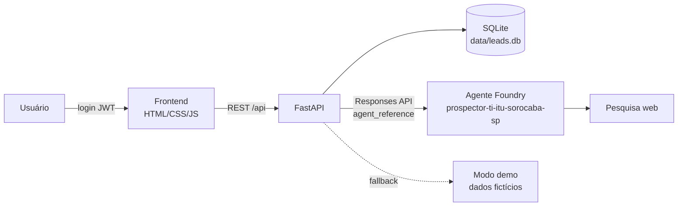

# Coleta de Leads · Prospector de TI

Demonstração funcional de um coletor de leads B2B. Um **agente publicado no Azure AI Foundry** pesquisa na web empresas de
**Itu, Sorocaba e São Paulo** que precisam de um parceiro de TI. Um app web (FastAPI + SQLite + frontend responsivo) armazena
os leads e monta um **ranking de oportunidades**. O acesso exige login e senha.

Portfólio considerado pelo agente: Acronis (backup, DR e cibersegurança), serviços gerenciados, Modern Work com Microsoft 365,
residentes N1/N2, gerenciamento de banco de dados, redes e Fortigate, Windows Server e AD, e infraestrutura cabeada.

## Arquitetura



| Pasta/arquivo | Conteúdo |
|---|---|
| `agent/instructions.md` | Instruções (prompt) do agente, em português, com o formato JSON de saída |
| `agent/provision_agent.py` | Script reproduzível que cria uma nova versão do agente no Foundry |
| `agent/agent_info.json` | Registro do agente criado (nome, ID/versão, modelo, ferramentas) |
| `agent/test_agent.py` | Teste rápido do agente pelo terminal |
| `app/` | Backend FastAPI (`main.py`, autenticação, banco, ranking, cliente Foundry, modo demo) |
| `app/static/` | Frontend (login, dashboard, filtros, detalhes e nova coleta) |

## Agente no Foundry

- **Projeto:** `https://foundry-hackbr-ghcp.services.ai.azure.com/api/projects/prj-foundry-HackBR-GHCP-24`
- **Agente:** `prospector-ti-itu-sorocaba-sp`. A versão atual está em [`agent/agent_info.json`](agent/agent_info.json).
- **Modelo:** deployment `gpt-4o`, o único deployment de chat disponível no projeto.
- **Pesquisa web:** ferramenta `web_search` nativa dos agentes do Foundry. O projeto não tem conexão **Bing Grounding**. Se uma for
  criada no futuro, o script a detecta (ou use `FOUNDRY_BING_CONNECTION_NAME`) e passa a usar `bing_grounding`. Se nenhuma
  ferramenta de pesquisa estiver disponível, o agente é criado sem ela e informa isso no campo `observacoes`.
- **Saída:** JSON com empresa, CNPJ, site, cidade, segmento, porte, necessidades, sinais (com fontes), serviços recomendados,
  justificativa, `score_oportunidade` (0–100), nível de confiança e contato sugerido (apenas cargo e canal, sem dados pessoais).
- O agente é instruído a retornar **clientes finais**: exclui MSPs, integradores e revendas de TI, que são concorrentes. Também não
  retorna setores genéricos, e o backend filtra essas entradas por segurança.

## Pré-requisitos

- Python 3.10 ou superior
- Azure CLI (`winget install Microsoft.AzureCLI`) e uma conta com acesso ao projeto Foundry (papel *Azure AI User* ou superior)

## Instalação

```powershell
python -m venv .venv
.\.venv\Scripts\Activate.ps1
pip install -r requirements.txt
Copy-Item .env.example .env   # edite APP_PASSWORD e JWT_SECRET
```

Variáveis principais do `.env`, que **não é versionado**:

| Variável | Descrição |
|---|---|
| `FOUNDRY_PROJECT_ENDPOINT` | Endpoint do projeto Foundry |
| `FOUNDRY_MODEL_DEPLOYMENT` | Deployment do modelo (vazio = escolha automática) |
| `FOUNDRY_AGENT_NAME` / `FOUNDRY_AGENT_ID` | Preenchidos pelo script de provisionamento |
| `APP_MODE` | `auto` (Foundry com fallback para demo), `foundry` ou `mock` |
| `APP_USERNAME` / `APP_PASSWORD` | Usuário de demonstração. A senha é gravada no banco só como hash PBKDF2-SHA256 |
| `JWT_SECRET` | Segredo de assinatura dos tokens (`python -c "import secrets;print(secrets.token_urlsafe(48))"`) |
| `SEED_DEMO_DATA` | Popula o banco com leads fictícios na primeira execução |

A autenticação no Azure usa **Entra ID** (`DefaultAzureCredential`). Nenhuma chave de API é usada nem gravada.

## Provisionar o agente

```powershell
az login                                   # ou: az login --use-device-code
python agent/provision_agent.py --list     # lista deployments e conexões
python agent/provision_agent.py            # cria/atualiza o agente (nova versão)
python agent/test_agent.py Sorocaba 3      # testa o agente pelo terminal
```

Ao alterar `agent/instructions.md`, rode o script de novo para publicar uma nova versão.

## Executar o app

```powershell
python -m uvicorn app.main:app --port 8000
```

Abra <http://localhost:8000> e entre com o usuário e a senha definidos no `.env`.

- **Dashboard:** KPIs (total, oportunidades quentes, score médio, serviço mais demandado, última coleta).
- **Ranking:** lista ordenada pelo score final, com filtros por cidade, serviço, status, score mínimo e busca textual.
- **Detalhes:** justificativa, necessidades, sinais com fontes, contato sugerido e alteração de status
  (novo → contatado → qualificado → proposta / descartado).
- **Nova coleta:** escolha cidades, serviços prioritários, segmento e quantidade. A coleta roda em segundo plano (de 15 a 60 s
  com o Foundry) e os leads repetidos são atualizados (deduplicação por empresa + cidade).
- **Modo demo:** marque "Usar dados de demonstração" ou use `APP_MODE=mock` para gerar empresas **fictícias** marcadas com
  "(exemplo)" sem chamar o Foundry. Em `APP_MODE=auto`, falhas do Foundry também caem para o modo demo, com aviso.

### Cálculo do ranking

`score_final = 60% × score do agente + 40% × score heurístico`

O score heurístico combina aderência ao portfólio (35%), força dos sinais (25%), porte (20%), cidade (10%, com prioridade para
Itu e Sorocaba) e nível de confiança (10%). Faixas: **quente** ≥ 75, **morno** ≥ 55, **frio** < 55.

## API

Todas as rotas, exceto o login, exigem `Authorization: Bearer <token>`.

| Método | Rota | Descrição |
|---|---|---|
| POST | `/api/auth/login` | `{username, password}` → `{token}` |
| GET | `/api/leads` | Ranking. Filtros: `cidade`, `servico`, `status`, `min_score`, `q` |
| GET / PATCH | `/api/leads/{id}` | Detalhes / atualização de status |
| GET | `/api/stats`, `/api/meta` | KPIs e metadados |
| POST | `/api/collect` | Dispara uma coleta → `{job_id}` |
| GET | `/api/jobs/{id}` | Status da coleta |

## Observações

- Os resultados do agente vêm de pesquisa web e de um modelo de linguagem. **Valide os dados** (CNPJ, sinais e fontes) antes de
  entrar em contato. O campo `nivel_confianca` ajuda a priorizar.
- Para produção, recomenda-se: HTTPS, usuários em um provedor de identidade (por exemplo, Entra ID), uma fila para as coletas e um
  banco gerenciado.
