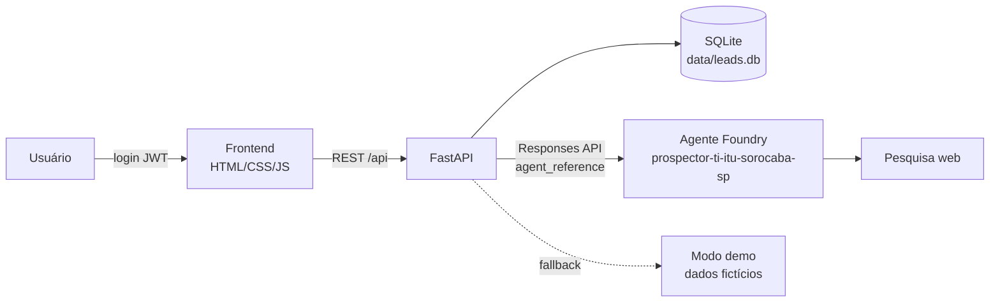

# Coleta de Leads · Prospector de TI

Demonstração funcional de um coletor de leads B2B. Um **agente publicado no Azure AI Foundry** pesquisa na web empresas a até
**3,5 horas de carro de Itu, Sorocaba ou São Paulo** que precisam de um parceiro de TI. Um app web (FastAPI + SQLite + frontend responsivo) armazena
os leads e monta um **ranking de oportunidades**. O acesso exige login e senha.

Portfólio considerado pelo agente: Acronis (backup, DR e cibersegurança), serviços gerenciados, Modern Work com Microsoft 365,
residentes N1/N2, gerenciamento de banco de dados, redes e Fortigate, Windows Server e AD, e infraestrutura cabeada.

## Arquitetura



| Pasta/arquivo | Conteúdo |
|---|---|
| `agent/instructions.md` | Instruções (prompt) do agente, em português, com o formato JSON de saída |
| `agent/provision_agent.py` | Script reproduzível que cria uma nova versão do agente no Foundry |
| `agent/agent_info.json` | Registro do agente criado (nome, ID/versão, modelo, ferramentas) |
| `agent/test_agent.py` | Teste rápido do agente pelo terminal |
| `app/` | Backend FastAPI (`main.py`, autenticação, banco, ranking, cliente Foundry, modo demo) |
| `app/static/` | Frontend (login, dashboard, filtros, detalhes e nova coleta) |

## Agente no Foundry

- **Projeto:** `https://foundry-hackbr-ghcp.services.ai.azure.com/api/projects/prj-foundry-HackBR-GHCP-24`
- **Agente:** `prospector-ti-itu-sorocaba-sp`, versão 10 (`prospector-ti-itu-sorocaba-sp:10`). A versão atual está em [`agent/agent_info.json`](agent/agent_info.json).
- **Região:** qualquer cidade a até 3,5 h de carro da base mais próxima (Itu, Sorocaba ou São Paulo). O agente informa a cidade
  real, `base_proxima`, `distancia_km` e `tempo_viagem_h` (estimativas por rodovia). O backend descarta leads acima do limite pedido.
- **Modelo:** deployment `gpt-4o`, o único deployment de chat disponível no projeto.
- **Pesquisa web:** ferramenta `web_search` nativa dos agentes do Foundry. O projeto não tem conexão **Bing Grounding**. Se uma for
  criada no futuro, o script a detecta (ou use `FOUNDRY_BING_CONNECTION_NAME`) e passa a usar `bing_grounding`. Se nenhuma
  ferramenta de pesquisa estiver disponível, o agente é criado sem ela e informa isso no campo `observacoes`.
- **Saída:** JSON com empresa, CNPJ, site, cidade, segmento, porte, necessidades, sinais (com fontes), serviços recomendados,
  justificativa, `score_oportunidade` (0–100), nível de confiança, contato sugerido (apenas cargo e canal) e e-mails de contato.
- **E-mails de contato (`contatos_email`):** o agente procura no site oficial (contato, rodapé, fale conosco, LGPD) os e-mails
  **corporativos genéricos publicados** (contato@, comercial@, ti@…). Cada e-mail traz a `fonte` (URL onde aparece) e o `tipo`:
  `encontrado` (publicado na fonte) ou `inferido` (padrão provável, não confirmado — valide antes de usar). O agente não inventa
  e-mails: sem resultado, a lista fica vazia e o lead é marcado como `nao_encontrado`. O backend valida o formato, descarta
  e-mails de outros domínios (agências, fornecedores) e trata e-mail sem fonte como `inferido`.
- **CNPJ (`cnpj`, `cnpj_fonte`):** o agente só informa o CNPJ quando o encontra em fonte pública e cita a URL. O backend confere
  os dígitos verificadores e descarta CNPJs inválidos.
- O agente é instruído a retornar **clientes finais**: exclui MSPs, integradores e revendas de TI, que são concorrentes. Também não
  retorna setores genéricos, e o backend filtra essas entradas por segurança.

## Pré-requisitos

- Python 3.10 ou superior
- Azure CLI (`winget install Microsoft.AzureCLI`) e uma conta com acesso ao projeto Foundry (papel *Azure AI User* ou superior)

## Instalação

```powershell
python -m venv .venv
.\.venv\Scripts\Activate.ps1
pip install -r requirements.txt
Copy-Item .env.example .env   # edite APP_PASSWORD e JWT_SECRET
```

Variáveis principais do `.env`, que **não é versionado**:

| Variável | Descrição |
|---|---|
| `FOUNDRY_PROJECT_ENDPOINT` | Endpoint do projeto Foundry |
| `FOUNDRY_MODEL_DEPLOYMENT` | Deployment do modelo (vazio = escolha automática) |
| `FOUNDRY_AGENT_NAME` / `FOUNDRY_AGENT_ID` | Preenchidos pelo script de provisionamento |
| `APP_MODE` | `auto` (Foundry com fallback para demo), `foundry` ou `mock` |
| `MAX_TRAVEL_HOURS` | Raio máximo da prospecção em horas de carro até a base mais próxima (padrão `3.5`) |
| `APP_USERNAME` / `APP_PASSWORD` | Usuário de demonstração. A senha é gravada no banco só como hash PBKDF2-SHA256 |
| `JWT_SECRET` | Segredo de assinatura dos tokens (`python -c "import secrets;print(secrets.token_urlsafe(48))"`) |
| `SEED_DEMO_DATA` | Popula o banco com leads fictícios na primeira execução |
| `VERIFICACAO_EXTERNA` | `true` (padrão) consulta APIs públicas para verificar CNPJ e rota de carro dos leads reais |

A autenticação no Azure usa **Entra ID** (`DefaultAzureCredential`). Nenhuma chave de API é usada nem gravada.

## Provisionar o agente

```powershell
az login                                   # ou: az login --use-device-code
python agent/provision_agent.py --list     # lista deployments e conexões
python agent/provision_agent.py            # cria/atualiza o agente (nova versão)
python agent/test_agent.py Campinas 3      # testa o agente pelo terminal (sem cidade = raio inteiro)
```

Ao alterar `agent/instructions.md`, rode o script de novo para publicar uma nova versão.

## Executar o app

```powershell
python -m uvicorn app.main:app --port 8000
```

Abra <http://localhost:8000> e entre com o usuário e a senha definidos no `.env`.

- **Dashboard:** KPIs (total, oportunidades quentes, leads com e-mail, score médio, serviço mais demandado, última coleta).
- **Ranking:** lista ordenada pelo score final, com filtros por cidade (as cidades reais já coletadas), base mais próxima,
  tempo de carro (até 1 h, 2 h ou 3,5 h), serviço, status, **com/sem e-mail**, score mínimo e busca textual. Cada lead mostra o
  tempo e a distância até a base e o e-mail principal (link `mailto:`, botão de copiar e selo *encontrado na fonte*/*inferido*/*manual*).
- **Detalhes:** justificativa, necessidades, sinais com fontes, localização (base, km e tempo de carro), e-mails de contato com a
  fonte de cada um, contato sugerido, pipeline do CRM e decomposição do score.
- **Mini CRM:** pipeline por lead **novo → contatado → reunião → proposta → ganho/perdido**. No detalhe do lead, clique na
  etapa para mover o lead, defina o **responsável**, a **próxima ação** e a data. Use **✓ Ação concluída** para registrar a
  conclusão e adicione **notas**. Tudo vai para o **histórico**, com autor e data/hora (tabela `notas`): notas, mudanças de
  etapa, de responsável e de próxima ação. Ações com data passada (fora de ganho/perdido) aparecem como **⏰ vencida** no
  ranking, no kanban e no KPI **Próximas ações vencidas**. Clicar no KPI filtra essas ações. O ranking tem filtros por
  **etapa**, **responsável** e **próxima ação** (vencidas/agendadas), e o botão **▦ Kanban** mostra o pipeline em colunas
  (arraste os cards entre as etapas no desktop; no celular, as colunas rolam na horizontal). A migração converte os status
  antigos (`qualificado` → `reuniao`, `descartado` → `perdido`) e adiciona as colunas `responsavel`, `proxima_acao` e
  `proxima_acao_data`, sem perder os leads. Uma nova coleta não altera a etapa nem os dados do CRM de leads existentes.
- **E-mails de leads já existentes:** o botão **✉ Buscar e-mails faltantes** pede ao agente os e-mails de todos os leads sem
  contato (4 em paralelo). No detalhe do lead, **🔎 Buscar com o agente** faz o mesmo para um lead e o campo de e-mail permite
  editar manualmente (vários separados por vírgula; vazio remove). Ao atualizar um lead numa nova coleta, os e-mails já conhecidos
  são mantidos. O banco é migrado automaticamente na inicialização (colunas `email` e `email_tipo`), sem perder os leads.
- **Dados verificados x estimados pela IA:** cada lead real passa por uma verificação em fontes públicas, e a UI mostra a
  origem de cada dado com selos **✓ verificado**, **≈ estimado pela IA** ou **✎ manual**:
  - **Cadastro (CNPJ):** consulta na [BrasilAPI](https://brasilapi.com.br) (dados da Receita Federal), com fallback para a
    [ReceitaWS](https://receitaws.com.br) (limite de 3 consultas/min). Traz razão social, nome fantasia, CNAE, porte, situação
    cadastral, endereço e data de abertura. Se o CNPJ for de outra unidade (por exemplo, a matriz), aparece o aviso
    "endereço em outra cidade".
  - **Rota:** a cidade do lead é geocodificada no [Nominatim/OpenStreetMap](https://nominatim.org) (1 req/s) e a rota de carro
    até cada base é calculada no [OSRM](https://project-osrm.org). Vale a base de menor tempo. Distância, tempo e base passam a
    ser os verificados, e a estimativa original da IA fica visível no detalhe. O tempo do OSRM **não considera trânsito**.
    Não havia conta Azure Maps acessível na assinatura, por isso foram usados os serviços abertos.
  - As respostas ficam em cache no SQLite (tabela `api_cache`) para respeitar os limites de uso. A verificação roda
    automaticamente ao fim de cada coleta real; para os leads sem CNPJ, o agente faz uma busca dedicada e o resultado é conferido
    na Receita. O botão **✓ Verificar CNPJ e rotas** verifica os leads pendentes. No detalhe do lead, dá para informar o CNPJ
    manualmente (**Salvar e verificar**) ou **Reverificar**. Leads de demonstração não fazem consultas externas.
- **Sinais de compra:** o agente busca sinais **datados e com URL da fonte** de cada empresa: vagas de TI, expansão ou nova
  unidade, incidentes de segurança, troca de sistemas/migração e notícias. Os sinais ficam na tabela `sinais` (tipo, descrição,
  data, fonte, peso) e aparecem numa **timeline** no detalhe do lead (ícone do tipo, data, "há X dias", peso efetivo e link da
  fonte). O ranking mostra quantos sinais com fonte cada lead tem e a idade do último. Após cada coleta real, o agente faz uma
  busca dedicada de sinais para os leads que ainda não têm sinal datado com fonte. O botão **📡 Buscar sinais** faz o mesmo sob
  demanda, e o detalhe tem **Buscar sinais recentes com o agente** para um lead. Na migração, os sinais antigos (texto) são
  copiados para a tabela; os sem data e sem fonte viram *indício* (peso baixo).
- **Nova coleta:** escolha as bases, o tempo máximo de carro (0,5 a 3,5 h), cidades específicas opcionais (texto livre),
  serviços prioritários, segmento e quantidade. A coleta roda em segundo plano (de 15 a 90 s
  com o Foundry) e os leads repetidos são atualizados (deduplicação por empresa + cidade).
- **Modo demo:** marque "Usar dados de demonstração" ou use `APP_MODE=mock` para gerar empresas **fictícias** marcadas com
  "(exemplo)" sem chamar o Foundry. Em `APP_MODE=auto`, falhas do Foundry também caem para o modo demo, com aviso.

### Cálculo do ranking (explicável e ajustável)

`score_final = Σ (peso do fator × valor do fator) ÷ Σ pesos × 100`

| Fator | Peso padrão | Valor (0–1) |
|---|---|---|
| Avaliação do agente (IA) | 50 | `score_oportunidade` ÷ 100 |
| Aderência aos serviços | 15 | soma dos pesos dos serviços recomendados ÷ 3 (máx. 1) |
| Sinais de compra | 12 | força dos sinais (abaixo) |
| Porte | 8 | média 1,0 · pequena 0,8 · grande 0,2 (com funcionários estimados: 1,0 dentro da faixa do perfil, menos fora dela) |
| Distância até a base | 6 | 1,0 na base, caindo até 0,3 com 3,5 h de carro (0,5 se desconhecida) |
| E-mail disponível | 5 | encontrado na fonte ou manual 1,0 · inferido 0,5 · sem e-mail 0 |
| Confiança dos dados | 4 | alta 1,0 · média 0,7 · baixa 0,4 |
| Perfil de cliente ideal | 15 | dentro do perfil 0,6–1,0 (mais dados conhecidos = maior) · exceção por terceirização 0,4 · fora 0 |

Cada serviço tem um peso de 0 a 3 (padrão 1): Acronis, Modern Work/serviços gerenciados, residentes N1/N2, banco de dados,
redes/Fortigate, Windows Server/AD e infraestrutura cabeada. Faixas: **quente** ≥ 75, **morno** ≥ 55, **frio** < 55.

- **⚙ Pesos** (no topo) abre a tela de configuração, com controles deslizantes para os pesos dos fatores (mostrados em %) e dos
  serviços. **Salvar e recalcular** grava os pesos na tabela `settings` e recalcula o ranking de todos os leads na hora, sem
  nova coleta. **Restaurar padrão** volta aos valores da tabela acima.
- No detalhe do lead, **Por que este score?** mostra a decomposição: cada fator com o valor, o motivo (por exemplo, "1h05 de
  carro até Itu" ou "7 sinais, 5 datados com fonte"), os pontos obtidos e o máximo possível, além dos serviços que contaram
  para a aderência.

### Perfil de cliente ideal (ICP)

O alvo são **PMEs de cerca de 20 a 500 funcionários** sem time de TI interno robusto, ou que já terceirizam TI. Grandes
corporações, multinacionais e grupos com TI própria (por exemplo, Toyota, Hyundai e grandes redes hospitalares) ficam
**fora do perfil**. Eles não são apagados: ficam ocultos por padrão e perdem uma **penalidade** de 60% do score.

Um lead fica **fora do perfil** quando ocorre qualquer uma destas condições:
- os funcionários estimados estão fora da faixa;
- o porte é "grande" e não há estimativa de funcionários;
- o agente indica TI interna estruturada, com evidência forte (gerência ou diretoria de TI, CIO, coordenação, equipe ou SOC
  próprio). Uma vaga isolada de analista ou suporte gera só um alerta;
- é um grupo multinacional;
- o capital social na Receita é ≥ R$ 50 mi.

FILIAL, sócio no exterior e porte "DEMAIS" sem número de funcionários geram apenas alertas. **Exceção:** quando há sinal
concreto de terceirização com URL de fonte, o lead permanece no perfil (valor 0,4).

- O agente (v10) devolve `funcionarios_estimados`, `ti_interna`, `multinacional` e `terceirizacao`. Cada campo traz
  `status` (sim/nao/desconhecido), evidência e fonte. A verificação de CNPJ acrescenta `capital_social` e sócios no exterior
  (QSA).
- A faixa de funcionários, o capital máximo e a penalidade (%) são ajustáveis em **⚙ Pesos → Perfil de cliente ideal**.
- O filtro **Perfil** do ranking tem três opções: no perfil (padrão), fora do perfil e todos. O KPI "Fora do perfil
  (ocultos)" é clicável.
- No detalhe do lead, a seção de perfil mostra os motivos, os alertas e as evidências com fonte, além dos botões **Marcar
  dentro**, **Marcar fora** e **Automático**. Essa sobreposição manual fica registrada no histórico.
- **Por que este score?** mostra o fator de perfil e a penalidade aplicada.
- **🎯 Reavaliar perfil** consulta o agente e atualiza o CNPJ (incluindo o capital social) de todos os leads reais. Os dados de
  CRM são preservados.
- Os KPIs consideram apenas os leads no perfil.

**Força dos sinais** (0–1) = Σ(peso do tipo × fator) ÷ 1,2, limitada a 1. Pesos por tipo: expansão 1,0; incidente 1,0; troca de
sistemas 0,9; vaga de TI 0,8; notícia 0,6; indício sem evidência 0,3. O fator decai com a idade (meia-vida de 180 dias:
`0,5 ^ (idade em dias / 180)`, mínimo 0,05). Sinais sem data valem 0,35, e sinais sem URL de fonte valem metade. Assim,
sinais recentes e comprovados pesam mais, e os scores são recalculados a cada inicialização.

## API

Todas as rotas, exceto o login, exigem `Authorization: Bearer <token>`.

| Método | Rota | Descrição |
|---|---|---|
| POST | `/api/auth/login` | `{username, password}` → `{token}` |
| GET | `/api/leads` | Ranking. Filtros: `cidade`, `base`, `max_horas`, `servico`, `status` (etapa), `min_score`, `q`, `com_email` (true/false), `responsavel`, `acao` (`vencida`/`agendada`), `perfil` (`dentro` padrão / `fora` / `todos`) |
| GET / PATCH | `/api/leads/{id}` | Detalhes (inclui `sinais` com `peso_efetivo`, `forca_sinais` e `score_detalhe` com a decomposição do score) / atualização de `status`, `email` manual (`"a@x.com, b@x.com"`; `""` remove) e/ou `cnpj` manual (verificado na hora; `""` remove), `responsavel`, `proxima_acao` e `proxima_acao_data` (AAAA-MM-DD; `""` remove), `perfil` (`dentro`/`fora`/`auto`) com `perfil_motivo` |
| POST | `/api/leads/{id}/notas` | `{texto}` → nota no histórico do lead (o histórico vem em `notas` no GET do lead) |
| GET / PUT | `/api/config/pesos` | Pesos do ranking (`{servicos: {acronis: 1, ...}, fatores: {agente: 50, ...}, perfil: {func_min: 20, func_max: 500, capital_max_mi: 50, penalidade: 60}}`); o PUT valida, salva e recalcula todos os scores |
| GET | `/api/stats`, `/api/meta` | KPIs e metadados |
| POST | `/api/collect` | `{bases, max_horas, cidades, servicos, segmento, quantidade, modo}` → `{job_id}` |
| POST | `/api/enrich` | `{lead_ids?, modo?}` → `{job_id}`. Busca e-mails via agente (sem `lead_ids`: todos os leads sem e-mail) |
| POST | `/api/verify` | `{lead_ids?, todos?, buscar_cnpj?}` → `{job_id}`. Verifica CNPJ e rota (sem `lead_ids`: leads reais pendentes; `todos=true` reverifica todos) |
| POST | `/api/signals` | `{lead_ids?, modo?}` → `{job_id}`. Busca sinais de compra datados via agente (sem `lead_ids`: leads reais sem sinal datado com fonte) |
| POST | `/api/perfil` | `{lead_ids?, modo?}` → `{job_id}`. Reavalia o perfil de cliente ideal via agente + CNPJ (sem `lead_ids`: todos os leads reais) |
| GET | `/api/jobs/{id}` | Status da coleta / do enriquecimento / da verificação |

## Observações

- Os resultados do agente vêm de pesquisa web e de um modelo de linguagem. **Valide os dados** (CNPJ, sinais e fontes) antes de
  entrar em contato. O campo `nivel_confianca` ajuda a priorizar.
- **CNPJ e rotas:** os dados cadastrais vêm da Receita Federal, mas a associação empresa ↔ CNPJ é feita pelo agente. Confira
  a razão social exibida. O tempo de viagem é calculado sem trânsito.
- **E-mails:** confira a fonte antes do envio, principalmente os `inferido`. Use-os apenas para contato comercial B2B legítimo,
  respeitando a LGPD (base legal de legítimo interesse, opção de descadastro). No modo demo, os e-mails usam o domínio
  reservado `.example` e não existem.
- Para produção, recomenda-se: HTTPS, usuários em um provedor de identidade (por exemplo, Entra ID), uma fila para as coletas e um
  banco gerenciado.
